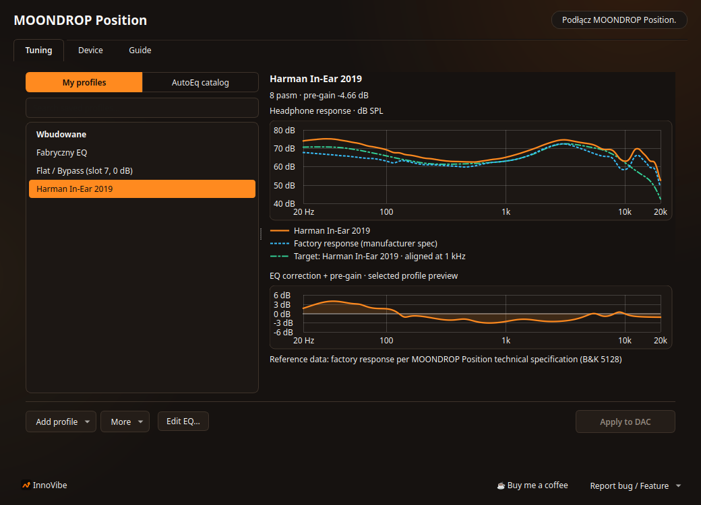

# MOONDROP Position — Native Linux DSP, AutoEq & Gaming Audio Controller

🌐 **Language:** English | [Polski](README.pl.md)

[-2ea44f?logo=linux&logoColor=white)](#quick-start)
[](#quick-start)
[-41cd52?logo=qt&logoColor=white)](#screenshots)
[](LICENSE)

**Unlock the full hardware DSP of your MOONDROP Position (`35d8:0123`) natively on Linux — zero browser needed, zero CPU overhead, full AutoEq integration.**

Whether you're fragging in Counter-Strike / Steam Proton or fine-tuning your IEMs to Harman, Diffuse Field, or your own REW measurements, this app brings **100% of the official web configurator's capabilities ([hub.moondroplab.tech](https://hub.moondroplab.tech/))** directly to your Linux desktop — plus thousands of AutoEq profiles and PipeWire UAC2 control.

---

## Why Use the Native Linux App?

### 1. Built for Linux Gaming & Low-Latency Audio
- **Zero CPU DSP:** Your 8-band parametric EQ runs directly on the MOONDROP Position hardware chip (`< 5 ms` latency). Your tuning stays active in every Steam/Proton game, Discord voice chat, and media player — even when you close the app or switch PCs.
- **PipeWire / UAC2 Sample Rate Control:** Inspect active ALSA streams (`S16_LE` / `S24_3LE` / `S32_LE`) and force sample rates (`44.1` to `384 kHz`) via PipeWire right from the **Device** tab.
- **System Tray Ready:** Minimize to the system tray and switch EQ profiles in two clicks between gaming, music, and calls.

### 2. Massive AutoEq Database Built In
- **Thousands of IEM & Headphone Measurements:** Browse and filter the full AutoEq catalog (Crinacle, Oratory1990, Rtings, and more) or load your own REW/CSV/TXT target curves.
- **Hardware-Aware 8-Band Optimization:** Automatically fits your chosen target curve to MOONDROP Position's exact 8 hardware biquad filters (`96 kHz` DSP, `PK / LP / HP`, `20–20,000 Hz`, `-18…+12 dB`), with real-time frequency response preview against the factory technical specification curve (B&K 5128).

### 3. Full Feature Parity with `hub.moondroplab.tech` — Plus Offline Safety
| Feature | Official Web Hub | MOONDROP Position for Linux |
|---|---|---|
| 8-band Parametric EQ (`PK / LP / HP`) + Pre-gain | Yes (WebHID / Chromium) | **Yes (Native USB HID `0x4B`, works offline)** |
| Live Auditioning (`Odsłuch na żywo`) | Yes | **Yes, with automatic safe state restore on cancel** |
| Built-in AutoEq Optimizer (thousands of IEMs) | Basic presets | **Full AutoEq catalog + custom CSV/TXT + plots** |
| Output Gain (`-18…0 dB`) & Mic Gain | Yes | **Yes, optional per-profile bundling** |
| Disk Profile Library vs DAC Flash Separation | Limited | **Full local library, JSON & Equalizer APO import/export** |
| PipeWire UAC2 Stream & Sample Rate Monitor | No | **Yes (`44.1–384 kHz` + ALSA bit-depth readout)** |
| Readback Verification & Backup | Basic | **Strict pre/post-flash verification & 1-click backup** |

---

## Screenshots

### Tuning & Frequency Response Preview


### Built-in AutoEq Catalog


### 8-Band Parametric EQ Editor (with Live Preview)


### Device Status, Gains & PipeWire UAC2 Quality


### Built-in Guide, Shortcuts & Support


---

## Quick Start

### 1. Try the Interactive Simulator (No Hardware Required)
You can explore the entire UI, plots, AutoEq catalog, and EQ editor without plugging in the DAC:

```bash
git clone https://github.com/tom3k5/moondrop-position-dac.git
cd moondrop-position-dac
python3 skrypty/position_gui.py --demo
```

### 2. Enable USB HID Access on Linux (One-Time `udev` Rule)
Audio playback works out of the box with PipeWire. To allow non-root DSP/EQ control over `/dev/hidraw*`:

```bash
sudo cp udev/70-moondrop-position.rules /etc/udev/rules.d/
sudo udevadm control --reload-rules && sudo udevadm trigger
```
Replug your MOONDROP Position and verify detection:
```bash
python3 skrypty/position_gui.py --diagnose
```

### 3. Install via Flatpak (Recommended)
Download the latest `position-dac.flatpak` bundle from [**GitHub Releases**](https://github.com/tom3k5/moondrop-position-dac/releases/latest) (includes PySide6 and the full AutoEq optimizer out of the box):

```bash
flatpak install --user position-dac.flatpak
flatpak run local.moondrop.Position
```

*(Note: to control the physical DAC over USB HID from Flatpak or source, install the host `udev` rule from Step 2.)*

### 4. Or Run Directly from Source
```bash
python3 skrypty/position_gui.py
```
*(Optional: for running the AutoEq optimizer from source, set up the `.venvs/autoeq` Python 3.11 environment as described in [`docs/integracja-autoeq.md`](docs/integracja-autoeq.md).)*

### 5. Build Flatpak Locally & Permissions Note
```bash
flatpak-builder --force-clean --disable-rofiles-fuse --repo=flatpak-repo flatpak-build local.moondrop.Position.json
flatpak build-bundle flatpak-repo position-dac.flatpak local.moondrop.Position
```
The Flatpak manifest ([`local.moondrop.Position.json`](local.moondrop.Position.json)) requests `--device=all` for USB `hidraw` DSP access, `--share=network` for user-initiated AutoEq catalog downloads, `--talk-name=org.kde.StatusNotifierWatcher` for the system tray icon, and `--socket=wayland` / `--socket=fallback-x11` / `--share=ipc` for the desktop window.

---

## Support, Feedback & Author

- **Author:** [InnoVibe](https://www.innovibe.pl/en)
- **Buy me a coffee:** Enjoying the app? [Support development (PL & EU payments)](https://www.innovibe.pl/en/coffee) — or click **☕ Buy me a coffee** directly in the app footer.
- **Found a bug or have an idea?** Use the in-app **Report bug / Feature** button (which includes a 1-click diagnostic copy) or open an issue directly on [GitHub Issues](https://github.com/tom3k5/moondrop-position-dac/issues/new/choose). Structured issue forms are automatically labeled by area.

---

## Technical Documentation

- [`docs/protokol-hid.md`](docs/protokol-hid.md) — Complete reverse-engineered USB HID `0x4B` DSP protocol (biquad Q2.30 encoding, slots, pre-gain, global/mic gain).
- [`docs/integracja-autoeq.md`](docs/integracja-autoeq.md) — AutoEq catalog pipeline and 8-band PK optimization details.
- [`docs/zrodla.md`](docs/zrodla.md) — Hardware descriptors, UAC2 modes, and reference configurations.
