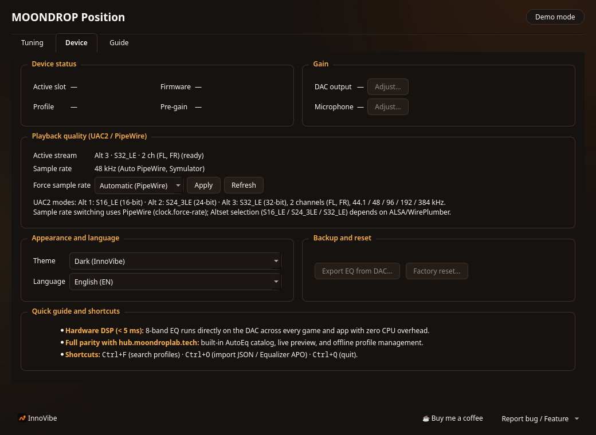
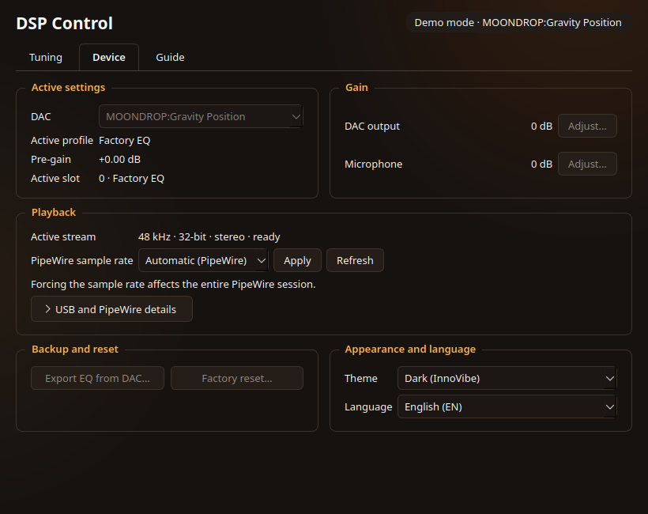

# DSP Control

🌐 **Language:** English | [Polski](README.pl.md)

[-2ea44f?logo=linux&logoColor=white)](#quick-start)
[](#quick-start)
[-41cd52?logo=qt&logoColor=white)](#screenshots)
[](LICENSE)

**Native Linux hardware DSP & AutoEq controller for MOONDROP USB-C DACs — zero CPU load, offline 6,800+ headphone catalog, quick tone shaping, Profile A vs B comparison, and live A/B auditioning.**

[Key Features](#key-features) · [Quick Start](#quick-start) · [Supported Hardware](#supported-hardware) · [Screenshots](#screenshots) · [vs Web Hub](#dsp-control-vs-official-web-hub) · [Docs](#technical-documentation) · [Support](#support-the-project)

<p align="center">
  
</p>

---

## Key Features

- **Any Headphones on Your DAC (Offline from Day 1):** Ships with a 6,800+ AutoEq headphone index and 9 MIT target curves offline. Pick any IEMs or headphones (e.g. KZ ZSN Pro X, Sennheiser, or custom CSV/TXT), adjust **Bass**, **Tilt**, or **PK only**, and compute hardware-ready EQ in seconds.
- **Faster EQ Shaping & Safe Auditioning:** Drag points directly on the curve, use the always-open **Quick tone shaping** row (**Bass → Mids → Treble → Tilt**), mute (`On`) or temporarily `Solo` (`S`) individual bands, paste Equalizer APO / Squiglink presets, or zero the EQ in one click.
- **Compare Sounds Effortlessly:** Compare **Profile A vs Profile B** side by side on both Tuning charts, and switch live **A/B** auditioning between **Flat (0 dB)**, **Initial state**, or **Profile B** (in RAM, without flash writes).
- **Hardware DSP, Zero CPU Load:** EQ runs directly on the DAC chip (`< 5 ms` latency) across Steam/Proton games, Discord, and media players — even after closing the app or plugging the DAC into another computer. Unlocks hardware `LSQ`/`HSQ` shelf filters on MOONDROP:Gravity Position.
- **Safe Library & Backups:** Local profile storage is separated from DAC flash (with pre/post-flash verification and 1-click **Restore previous**). Export or import your entire library as a `.zip` bundle (including Drag & Drop), with per-DAC last profile and headphone memory.

---

## Quick Start

### 1. Install via Flatpak (Recommended)
Download `dsp-control.flatpak` from [**GitHub Releases**](https://github.com/tom3k5/moondrop-position-dac/releases/latest) (bundles PySide6 and the full AutoEq optimizer):

```bash
flatpak install --user dsp-control.flatpak
```

### 2. Enable USB HID Access (One-Time `udev` Rule)
Audio playback works out of the box in PipeWire. To allow non-root EQ/DSP control over `/dev/hidraw*`:

```bash
sudo cp udev/70-dsp-control.rules /etc/udev/rules.d/
sudo udevadm control --reload-rules && sudo udevadm trigger
```

Replug your DAC and launch the app:

```bash
flatpak run pl.innovibe.DspControl
```

<details>
<summary>Run from source, try <code>--demo</code> mode without a DAC, or build Flatpak locally</summary>

Explore the full UI, AutoEq catalog, and EQ editor with no hardware connected:

```bash
git clone https://github.com/tom3k5/moondrop-position-dac.git
cd moondrop-position-dac
python3 scripts/dsp_control.py --demo
# Preview another DAC model in demo mode:
python3 scripts/dsp_control.py --demo --model moondrop-chu2-dsp
python3 scripts/dsp_control.py --demo --model moondrop-echo-a
```

Run from source against a physical DAC (including experimental **CHU II DSP** / **ECHO-A**) or verify detection without root:

```bash
python3 scripts/dsp_control.py --diagnose
python3 scripts/dsp_control.py
```

*(Optional: to run the AutoEq optimizer from source, set up `.venvs/autoeq` with Python 3.11 as described in [`docs/autoeq-integration.md`](docs/autoeq-integration.md).)*

Build Flatpak locally:

```bash
flatpak-builder --force-clean --disable-rofiles-fuse --repo=flatpak-repo flatpak-build pl.innovibe.DspControl.json
flatpak build-bundle flatpak-repo dsp-control.flatpak pl.innovibe.DspControl
```

The manifest ([`pl.innovibe.DspControl.json`](pl.innovibe.DspControl.json)) requests `--device=all` (USB `hidraw` DSP access), `--share=network` (user-initiated AutoEq catalog downloads & update checks), `--talk-name=org.kde.StatusNotifierWatcher` (system tray), and `--socket=wayland` / `--socket=fallback-x11` / `--share=ipc`. For a strictly offline session, run `flatpak run --unshare=network pl.innovibe.DspControl`.

</details>

---

## Supported Hardware

| Model | USB VID:PID | EQ & Filters | Status |
|---|---|---|---|
| **MOONDROP:Gravity Position** | `35d8:0123` | 8 bands (`PK`, `LSQ`, `HSQ`, `LP`, `HP`), pre-gain | **Verified** on physical hardware (Flatpak + source) |
| **MOONDROP CHU II DSP** | `31b2:0113` | 5 bands (`PK`, `LSQ`, `HSQ`), KTMicro KT0210 | **Experimental** (source builds, verified on captured HID frames) |
| **MOONDROP ECHO-A** | `3302:12c5` | 8 bands (`PK`, `LSQ`, `HSQ`, `LP`, `HP`), WalkPlay | **Experimental** (source builds, verified on captured HID frames) |

> [!NOTE]
> **Own a CHU II DSP or ECHO-A?** Help promote them from experimental to verified! Follow the [**Hardware Tester Guide**](docs/tester-guide.md) and submit a [**Hardware Test Report**](https://github.com/tom3k5/moondrop-position-dac/issues/new?template=hardware-test-report.yml) (includes rootless `--diagnose`).

---

## Screenshots

### 1. Tuning & Profile A vs B Comparison
**Selected profile** and **Active on DAC** stay clearly separated until you click **Apply to DAC** (which becomes **Restore previous** after flashing). Use the **Headphones** bar to pair any model, **Compare (B)** (or right-click a profile) to overlay a second profile on both plots, and **Add ▾ / More ▾** (or Drag & Drop) for `.zip` library bundles.

<details>
<summary>Compact Tuning view (640×620)</summary>

<p align="center">
  
</p>

</details>

<br>

### 2. Built-in AutoEq Catalog (6,800+ Models)
Filter thousands of IEM and over-ear measurements by **Source**, **Headphone type**, and **Fit range** (`20 Hz–20 kHz` or `6 / 4 / 2 kHz`), tweak **Bass**, **Tilt**, or **PK only** before computing, or drop your own `.csv` / `.txt` curve onto the window.

<p align="center">
  
</p>

<br>

### 3. Parametric EQ Editor, Quick Tone Shaping & Live A/B
Drag handles directly on the **EQ correction** plot, scroll to adjust Q, mute (`On`) or temporarily `Solo` (`S`) individual bands, and shape overall tone in the **Quick tone shaping** row (**Bass → Mids → Treble → Tilt**). With a DAC connected, **Live preview** lets you compare against **Flat**, **Initial**, or **Profile B** via **A/B** and safely restores your previous settings if canceled.

<p align="center">
  
</p>

<br>

### 4. Device Status, Gains & PipeWire UAC2 Quality
Inspect active ALSA bit depth, set session-wide **PipeWire sample rate** (`44.1–384 kHz`), export/restore DAC backups, and switch between **InnoVibe Dark / Light** themes and **EN / PL** languages.

<p align="center">
  
</p>

<details>
<summary>Compact Device view</summary>

<p align="center">
  
</p>

</details>

<br>

### 5. Built-in Guide, Updates & Diagnostics
In-app walkthroughs, keyboard shortcuts (`Ctrl+F`, `Ctrl+O`, `Ctrl+Q`), 1-click diagnostic copy, and update checks with 1-click Flatpak update command copy.

<p align="center">
  
</p>

---

## DSP Control vs Official Web Hub

| Feature | Official Web Hub | DSP Control |
|---|---|---|
| Parametric EQ (`PK / LSQ / HSQ / LP / HP`) + Pre-gain | `PK / LP / HP` only (shelves disabled on Position) | **Unlocks `LSQ / HSQ` (`1× LSQ + 1× HSQ + 6× PK`), native USB HID `0x4B`, offline** |
| EQ Editing & Tone Shaping | Sliders only | **Draggable curve points (Freq / Gain / Wheel Q), Quick tone shaping (`Bass / Mids / Treble / Tilt`), band Mute & Solo, Auto Headroom & Zero EQ** |
| Live Auditioning & A/B | Basic | **Auto-enabled + `A/B` target selector (`Flat 0 dB` / `Initial` / `Profile B`) + safe restore** |
| AutoEq Optimizer | Basic presets | **6,800+ offline index + Bass / Tilt / PK-only + fit range + Drag & Drop** |
| Profile & DSP Comparison | No | **Compare against Current in DSP or any Profile B on both plots, toggle/solo pills, `Hz / dB / Δ dB`** |
| Local Library & Portability | Limited | **Full local library, `.zip` bundle export/import (Drag & Drop), per-DAC last profile & headphone auto-sync, Equalizer APO paste/import/export** |
| PipeWire UAC2 & System Tray | No | **Sample rate control (`44.1–384 kHz`), ALSA bit-depth readout, 2-click tray switcher** |
| Safety & Updates | Basic | **Pre/post-flash verification, 1-click Restore previous, rootless `--diagnose`, Guide update checker** |

---

## Technical Documentation

- [`docs/hid-protocol.md`](docs/hid-protocol.md) — Reverse-engineered USB HID `0x4B` DSP protocol (Q2.30 biquad encoding, slots, pre-gain, global/mic gain).
- [`docs/autoeq-integration.md`](docs/autoeq-integration.md) — AutoEq catalog pipeline and 8-band (`LSQ + HSQ + 6× PK` / `PK`) optimization details.
- [`docs/tester-guide.md`](docs/tester-guide.md) — Step-by-step verification guide for CHU II DSP & ECHO-A testers.
- [`docs/sources.md`](docs/sources.md) — Hardware USB descriptors, UAC2 modes, and open-source references.

---

## Support the Project

> [!TIP]
> **Enjoying DSP Control?**
> If this app helps you get better sound out of your DAC on Linux, consider supporting continued development — every coffee helps keep updates, hardware testing, and new features coming!

- ☕ **Buy me a coffee:** Visit the [**InnoVibe support page**](https://innovibe.pl/en/ko-fi/) or click **Buy me a coffee…** in the app's **Guide** tab.
- 🌐 **Project Page:** [DSP Control on InnoVibe](https://innovibe.pl/en/dsp-control/)
- 🐛 **Bugs, Hardware Reports & Ideas:** Submit a [Hardware Test Report](https://github.com/tom3k5/moondrop-position-dac/issues/new?template=hardware-test-report.yml) or open an issue on [GitHub Issues](https://github.com/tom3k5/moondrop-position-dac/issues/new/choose).
