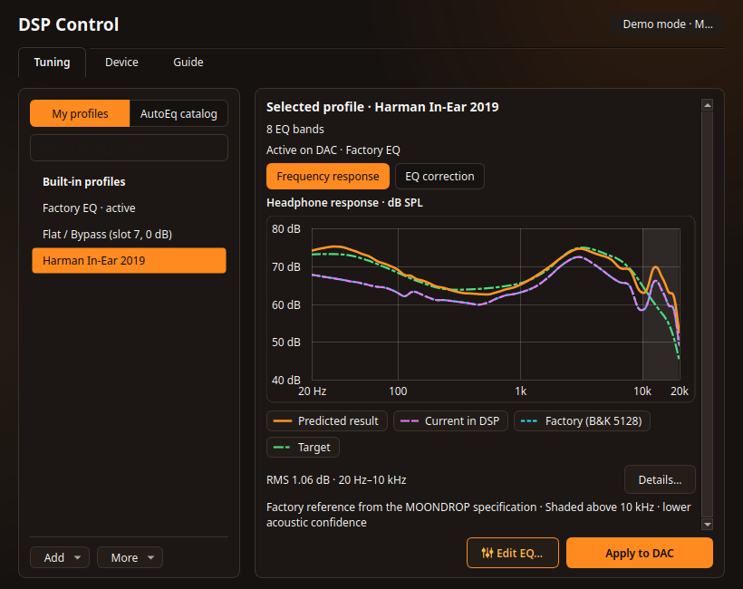
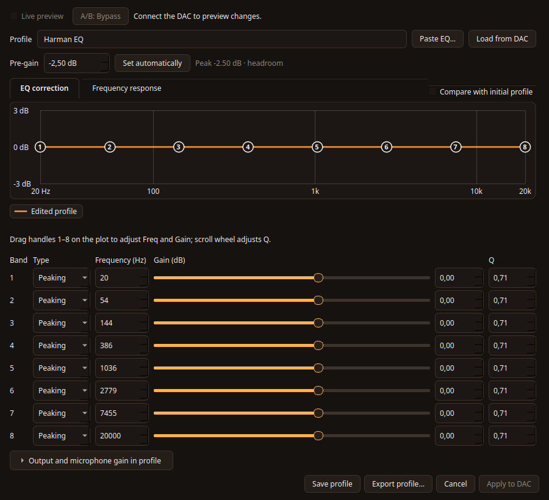

# DSP Control

🌐 **Language:** English | [Polski](README.pl.md)

[-2ea44f?logo=linux&logoColor=white)](#quick-start)
[](#quick-start)
[-41cd52?logo=qt&logoColor=white)](#screenshots)
[](LICENSE)

**Native Linux hardware DSP, AutoEq & PipeWire controller for MOONDROP USB-C DACs — zero CPU overhead, offline 6,800+ AutoEq index, unlocked `LSQ`/`HSQ` shelf filters, and live preview.**

[Supported Hardware](#supported-hardware) · [Quick Start](#quick-start) · [Why DSP Control?](#why-use-the-native-linux-app) · [Screenshots](#screenshots) · [Docs](#technical-documentation) · [Support](#support-the-project)


---

## Supported Hardware

| Model | USB VID:PID | EQ & Filters | Status |
|---|---|---|---|
| **MOONDROP:Gravity Position** | `35d8:0123` | 8 bands (`PK`, `LSQ`, `HSQ`, `LP`, `HP`), pre-gain | **Verified** on physical hardware (Flatpak + source) |
| **MOONDROP CHU II DSP** | `31b2:0113` | 5 bands (`PK`, `LSQ`, `HSQ`), KTMicro KT0210 | **Experimental** (source builds, verified on captured HID frames) |
| **MOONDROP ECHO-A** | `3302:12c5` | 8 bands (`PK`, `LSQ`, `HSQ`, `LP`, `HP`), WalkPlay | **Experimental** (source builds, verified on captured HID frames) |

> [!NOTE]
> **Own a CHU II DSP or ECHO-A?** Help promote them from experimental to verified! Follow the [**Hardware Tester Guide**](docs/tester-guide.md) and submit a [**Hardware Test Report**](https://github.com/tom3k5/moondrop-position-dac/issues/new?template=hardware-test-report.yml) (includes rootless `--diagnose`).

---

## Quick Start

DSP Control ships the AutoEq model/source index and 9 MIT target curves offline from first launch; index refreshes and curve downloads run directly over HTTPS with no GitHub sign-in or REST API rate limits.

### 1. Install via Flatpak (Recommended for Position)
Download `dsp-control.flatpak` from [**GitHub Releases**](https://github.com/tom3k5/moondrop-position-dac/releases/latest) (bundles PySide6 and the full AutoEq optimizer):

```bash
flatpak install --user dsp-control.flatpak
flatpak run pl.innovibe.DspControl
```

### 2. Enable USB HID Access (One-Time `udev` Rule)
Audio playback works out of the box in PipeWire. To allow non-root DSP/EQ control over `/dev/hidraw*` (required for both Flatpak and running from source):

```bash
sudo cp udev/70-dsp-control.rules /etc/udev/rules.d/
sudo udevadm control --reload-rules && sudo udevadm trigger
```

Replug your DAC and verify detection without root:

```bash
python3 scripts/dsp_control.py --diagnose
```

If multiple supported DACs are attached, use `list` in the HID CLI and pass `--device /dev/hidrawN` (or pick the unit under **Device** in the GUI). A single DAC is selected automatically.

### 3. Run from Source (Experimental CHU II DSP / ECHO-A or `--demo` Mode)
Explore the full UI, AutoEq catalog, and EQ editor with no DAC connected:

```bash
git clone https://github.com/tom3k5/moondrop-position-dac.git
cd moondrop-position-dac
python3 scripts/dsp_control.py --demo
# Or preview another DAC model in demo mode:
python3 scripts/dsp_control.py --demo --model moondrop-chu2-dsp
python3 scripts/dsp_control.py --demo --model moondrop-echo-a
```

To run against a physical DAC (including experimental **CHU II DSP** / **ECHO-A**):

```bash
python3 scripts/dsp_control.py
```

*(Optional: to run the AutoEq optimizer from source, set up `.venvs/autoeq` with Python 3.11 as described in [`docs/autoeq-integration.md`](docs/autoeq-integration.md).)*

<details>
<summary>Build Flatpak locally &amp; sandbox permissions</summary>

```bash
flatpak-builder --force-clean --disable-rofiles-fuse --repo=flatpak-repo flatpak-build pl.innovibe.DspControl.json
flatpak build-bundle flatpak-repo dsp-control.flatpak pl.innovibe.DspControl
```

The manifest ([`pl.innovibe.DspControl.json`](pl.innovibe.DspControl.json)) requests `--device=all` (USB `hidraw` DSP access), `--share=network` (user-initiated AutoEq catalog downloads), `--talk-name=org.kde.StatusNotifierWatcher` (system tray icon), and `--socket=wayland` / `--socket=fallback-x11` / `--share=ipc` (desktop window). For a strictly offline session with local profiles and cached curves, run `flatpak run --unshare=network pl.innovibe.DspControl`.

</details>

---

## Why Use the Native Linux App?

- **Hardware DSP, Zero CPU Load:** Parametric EQ runs directly on the DAC chip (`< 5 ms` latency) and stays active across Steam/Proton games, Discord, and media players — even after closing the app or moving to another PC.
- **Unlocks `LSQ` & `HSQ` Shelf Filters:** While `hub.moondroplab.tech` disables shelf filters for Position (`PK / LP / HP` only), DSP Control unlocks hardware `LSQ` and `HSQ` shelves verified on firmware `0.5`. AutoEq defaults to `1× LSQ + 1× HSQ + 6× PK`, dropping Harman In-Ear 2019 RMS error from `2.20 dB` down to `0.47 dB`.
- **Per-DAC Curves, Profiles & Connected Headphones:** Each DAC model loads its own modular definition under [`data/devices/`](data/devices/README.md) (bands, sample rate, filter types, baseline curve), filters *My Profiles* to the active DAC, and lets you select any connected headphones from the AutoEq catalog (e.g. `KZ ZSN Pro X`), a local CSV/TXT curve, or **Flat** mode on detachable/standalone DACs.
- **Safe Offline Workflow:** Browsing, AutoEq fitting, and local profile storage are completely separated from DAC flash. Every write performs pre/post-flash verification, and live preview automatically restores your previous DAC state if you cancel.
- **System Tray & PipeWire Control:** Minimize to the tray to switch profiles in two clicks, check active ALSA bit depth, and optionally force the PipeWire sample rate (`44.1–384 kHz`).

| Feature | Official Web Hub | DSP Control |
|---|---|---|
| Parametric EQ (`PK / LSQ / HSQ / LP / HP`) + Pre-gain | `PK / LP / HP` only (shelves disabled on Position) | **Unlocks `LSQ / HSQ` (`1× LSQ + 1× HSQ + 6× PK`), native USB HID `0x4B`, offline** |
| Interactive EQ Curve & Headroom | Sliders only | **Drag points on plot (Freq / Gain / Wheel Q) + Auto Headroom & Clip Check** |
| Live Auditioning | Yes | **Yes, auto-enabled with safe state restore on cancel** |
| Built-in AutoEq Optimizer | Basic presets | **6,800+ offline index + 9 MIT targets + pre-fit preview + fit range + Drag & Drop** |
| Live DSP Comparison & Interactive Legend | No | **Compare against Current in DSP on both plots, toggle/solo pills, `Hz / dB / Δ dB`** |
| Output Gain (`-18…0 dB`) & Mic Gain | Yes | **Yes, optional per-profile bundling** |
| Local Library vs DAC Flash | Limited | **Full local library, Drag & Drop, JSON & Equalizer APO (`.txt`) import/export** |
| PipeWire UAC2 Monitor & Sample Rate | No | **Yes (`44.1–384 kHz` + ALSA bit-depth readout)** |
| Readback Verification & Diagnostics | Basic | **Pre/post-flash verification, 1-click Restore previous, rootless `--diagnose`** |
| Themes, Language & Built-in Guide | Web only | **InnoVibe Dark & Light themes, EN / PL, built-in Guide tab** |

---

## Screenshots

### 1. Tuning & Frequency Response Preview
**Selected profile** and **Active on DAC** stay clearly separated until you click **Apply to DAC** (which becomes **Restore previous** after flashing). **Headphone response** compares **Factory (B&K 5128)**, **Target**, **Predicted result**, and **Current in DSP**; **EQ correction** shows the electrical filter curve at `96 kHz` with interactive toggle/solo legend pills and `Hz / dB / Δ dB` hover readouts.

<details>
<summary>Compact Tuning view (640×620)</summary>



</details>

### 2. Built-in AutoEq Catalog (6,800+ Models)
Filter thousands of IEM and over-ear measurements by **Source**, **Headphone type**, and **Fit range** (`20 Hz–20 kHz` or `6 / 4 / 2 kHz`), or drop your own `.csv` / `.txt` curve onto the window.


### 3. Parametric EQ Editor & Live Preview
Drag handles directly on the **EQ correction** plot, scroll to adjust Q, and click **Set automatically** for headroom. With a DAC connected, **Live preview** lets you audition tweaks in real time and restores your previous settings if canceled.



### 4. Device Status, Gains & PipeWire UAC2 Quality
Inspect active ALSA bit depth, set session-wide **PipeWire sample rate** (`44.1–384 kHz`), export/restore DAC backups, and switch between **InnoVibe Dark / Light** themes and **EN / PL** languages.


<details>
<summary>Compact Device view</summary>


</details>

### 5. Built-in Guide, Shortcuts & Diagnostics
In-app walkthroughs, keyboard shortcuts (`Ctrl+F`, `Ctrl+O`, `Ctrl+Q`), 1-click diagnostic copy, and direct support links.


---

## Technical Documentation

- [`docs/hid-protocol.md`](docs/hid-protocol.md) — Reverse-engineered USB HID `0x4B` DSP protocol (Q2.30 biquad encoding, slots, pre-gain, global/mic gain).
- [`docs/autoeq-integration.md`](docs/autoeq-integration.md) — AutoEq catalog pipeline and 8-band (`LSQ + HSQ + 6× PK` / `PK`) optimization details.
- [`docs/tester-guide.md`](docs/tester-guide.md) — Step-by-step verification guide for CHU II DSP & ECHO-A testers.
- [`docs/sources.md`](docs/sources.md) — Hardware USB descriptors, UAC2 modes, and open-source references.

---

## Support the Project

> [!TIP]
> **Enjoying DSP Control?**
> If this app helps you get better sound out of your DAC on Linux, consider supporting continued development — every coffee helps keep updates, hardware testing, and new features coming!

- ☕ **Buy me a coffee:** Visit the [**InnoVibe support page**](https://innovibe.pl/en/ko-fi/) or click **Buy me a coffee…** in the app's **Guide** tab.
- 🌐 **Project Page:** [DSP Control on InnoVibe](https://innovibe.pl/en/dsp-control/)
- 🐛 **Bugs, Hardware Reports & Ideas:** Submit a [Hardware Test Report](https://github.com/tom3k5/moondrop-position-dac/issues/new?template=hardware-test-report.yml) or open an issue on [GitHub Issues](https://github.com/tom3k5/moondrop-position-dac/issues/new/choose).
