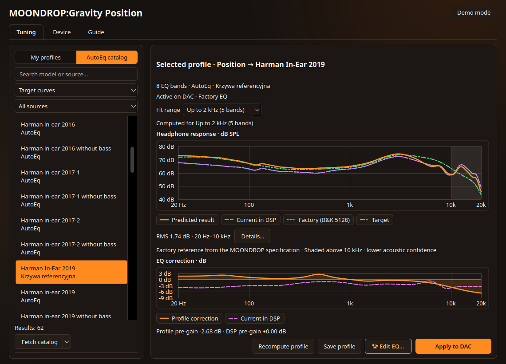
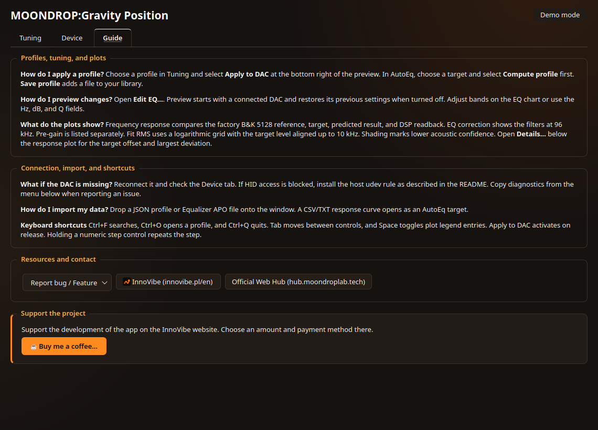

# MOONDROP:Gravity Position — Native Linux DSP, AutoEq & Gaming Audio Controller

🌐 **Language:** English | [Polski](README.pl.md)

[-2ea44f?logo=linux&logoColor=white)](#quick-start)
[](#quick-start)
[-41cd52?logo=qt&logoColor=white)](#screenshots)
[](LICENSE)

**Unlock the full hardware DSP of your MOONDROP:Gravity Position (`35d8:0123`) natively on Linux — zero browser needed, zero CPU overhead, full AutoEq integration.**

Whether you're fragging in Counter-Strike / Steam Proton or fine-tuning your IEMs to Harman, Diffuse Field, or your own REW measurements, this app brings **100% of the official web configurator's capabilities ([hub.moondroplab.tech](https://hub.moondroplab.tech/))** directly to your Linux desktop — plus thousands of AutoEq profiles and PipeWire UAC2 control.

---

## Why Use the Native Linux App?

### 1. Built for Linux Gaming & Low-Latency Audio
- **Zero CPU DSP:** Your 8-band parametric EQ runs directly on the MOONDROP:Gravity Position hardware chip (`< 5 ms` latency). Your tuning stays active in every Steam/Proton game, Discord voice chat, and media player — even when you close the app or switch PCs.
- **PipeWire / UAC2 Sample Rate Control:** Inspect active ALSA streams (`S16_LE` / `S24_3LE` / `S32_LE`) and force sample rates (`44.1` to `384 kHz`) via PipeWire right from the **Device** tab.
- **System Tray Ready:** Minimize to the system tray and switch EQ profiles in two clicks between gaming, music, and calls.

### 2. Massive AutoEq Database Built In
- **Massive AutoEq Database & Instant Target Preview:** Browse and filter the full AutoEq catalog (Crinacle, Oratory1990, Rtings, and more), load custom REW/CSV/TXT curves, or **drag & drop** `.json`, Equalizer APO `.txt`, and `.csv` files directly onto the window. Selecting any model previews its target curve alongside the factory baseline and **Current in DSP** response before you even run the optimizer.
- **Interactive Legend & Delta Crosshair:** Click legend pills under the plot to toggle curves across both charts, hover a pill to **solo** a curve, and hover anywhere on the plot for a live `Hz / dB / Δ dB` readout comparing your new tuning against **Current in DSP**.
- **Hardware-Aware 8-Band Optimization (`1× LSQ + 1× HSQ + 6× PK`):** Automatically fits your chosen target curve to MOONDROP:Gravity Position's exact 8 hardware biquad filters (`96 kHz` DSP, `PK / LSQ / HSQ / LP / HP`, `20–20,000 Hz`, `-18…+12 dB`). Unlike the manufacturer's web app (`hub.moondroplab.tech`, which disables shelf filters for Position and only exposes `PK / LP / HP`), this app unlocks the hardware `LSQ` and `HSQ` shelves verified on firmware 0.5 and defaults AutoEq to `1× LSQ + 1× HSQ + 6× PK` — achieving **significantly lower deviation** from the target curve (e.g. `0.47 dB` RMS / `3.12 dB` max vs `2.20 dB` RMS / `12.48 dB` max with `8× PK` only on Position → Harman In-Ear 2019). Includes a selectable **fit range** (`Full 20–20 kHz`, `Up to 6 kHz`, `4 kHz`, or `2 kHz` to leave upper bands free for manual treble tuning).

### 3. Full Feature Parity with `hub.moondroplab.tech` — Plus Offline Safety
| Feature | Official Web Hub | MOONDROP:Gravity Position for Linux |
|---|---|---|
| 8-band Parametric EQ (`PK / LSQ / HSQ / LP / HP`) + Pre-gain | Yes (`PK / LP / HP` only — shelves disabled) | **Yes — unlocks `LSQ / HSQ` (`1× LSQ + 1× HSQ + 6× PK`, much lower target deviation, native USB HID `0x4B`, offline)** |
| Interactive Plot Handles + Auto Headroom | Sliders only | **Drag handles `1–8` (Freq/Gain/Wheel Q) + Auto Headroom & Clip Check** |
| Live Auditioning (`Odsłuch na żywo`) | Yes | **Yes, with automatic safe state restore on cancel** |
| Built-in AutoEq Optimizer (thousands of IEMs) | Basic presets | **Full AutoEq catalog + pre-fit target preview + partial fit range + Drag & Drop CSV/TXT** |
| Live DSP Comparison & Interactive Plot Legend | No | **Compare against Current in DSP on both charts, toggle/solo legend pills, live `Hz / dB / Δ dB` crosshair** |
| Output Gain (`-18…0 dB`) & Mic Gain | Yes | **Yes, optional per-profile bundling** |
| Disk Profile Library vs DAC Flash Separation | Limited | **Full local library, Drag & Drop, JSON & Equalizer APO import/export** |
| PipeWire UAC2 Stream & Sample Rate Monitor | No | **Yes (`44.1–384 kHz` + ALSA bit-depth readout)** |
| Readback Verification & Backup | Basic | **Strict pre/post-flash verification & 1-click backup** |
| Themes, Language & Built-in Guide | Web only | **InnoVibe Dark & Light themes, EN / PL, Guide tab** |

---

## Screenshots

### Tuning & Frequency Response Preview
Tuning shows the **selected profile** and the **active profile on the DAC** separately. The charts and actions stay steady when switching built-in profiles. Editing and apply controls are grouped at the bottom right. The apply control shows **Already active on DAC** when the hardware matches the selection. The main window starts at up to 1140 × 820 logical pixels and fits the available desktop area. Compact windows let you switch between **Frequency response** and **EQ correction**.

**Factory**, **Target**, and **Predicted result** show the acoustic response. **EQ correction** shows the electrical response of the filters at 96 kHz, with profile and DSP pre-gain listed separately. **Current in DSP** uses the biquad coefficients read back from the device. **Details…** beside RMS under the response chart opens a dialog with the mean target offset and the largest deviation in the shared 20 Hz–10 kHz band. Shading above 10 kHz marks lower confidence in the acoustic comparison.


### Built-in AutoEq Catalog
Filter the catalog by form factor and measurement source. The preview groups the target, fit range, and the controls to compute or cancel. A completed profile records its fit range, including when saved to disk. If the range changes, recompute before saving or applying that result.



### 8-Band Parametric EQ Editor (with Interactive Handles & Live Preview)
Edit the electrical EQ curve using handles `1–8`, sliders, or numerical inputs. Switch to **Frequency response** to see the acoustic prediction. **Set automatically** calculates pre-gain from the available headroom. The live preview status stays above the editor and the save, apply, and export actions stay below the scrollable controls.


### Device Status, Gains & PipeWire UAC2 Quality
See the active profile, slot, gain, and stream format at a glance. Playback labels share a left edge. Backup and reset controls share the card width and stack in narrow windows. Open **USB and PipeWire details** for the raw format, firmware, and sample-rate details. Forcing the sample rate affects the whole PipeWire session.


### Built-in Guide, Shortcuts & Support
Controls show distinct hover, press, and keyboard focus states. Holding the apply button runs the action once on release. Numeric step controls repeat while held.



---

## Quick Start

### 1. Try the Interactive Simulator (No Hardware Required)
You can explore the entire UI, plots, AutoEq catalog, and EQ editor without plugging in the DAC:

```bash
git clone https://github.com/tom3k5/moondrop-position-dac.git
cd moondrop-position-dac
python3 skrypty/position_gui.py --demo
```

### 2. Enable USB HID Access on Linux (One-Time `udev` Rule)
Audio playback works out of the box with PipeWire. To allow non-root DSP/EQ control over `/dev/hidraw*`:

```bash
sudo cp udev/70-moondrop-position.rules /etc/udev/rules.d/
sudo udevadm control --reload-rules && sudo udevadm trigger
```
Replug your MOONDROP:Gravity Position and verify detection:
```bash
python3 skrypty/position_gui.py --diagnose
```
The diagnostic JSON includes the active slot, pre-gain, band parameters, and the raw Q2.30 coefficients as hexadecimal strings.

### 3. Install via Flatpak (Recommended)
Download the latest `position-dac.flatpak` bundle from [**GitHub Releases**](https://github.com/tom3k5/moondrop-position-dac/releases/latest) (includes PySide6 and the full AutoEq optimizer out of the box):

```bash
flatpak install --user position-dac.flatpak
flatpak run local.moondrop.Position
```

*(Note: to control the physical DAC over USB HID from Flatpak or source, install the host `udev` rule from Step 2.)*

### 4. Or Run Directly from Source
```bash
python3 skrypty/position_gui.py
```
*(Optional: for running the AutoEq optimizer from source, set up the `.venvs/autoeq` Python 3.11 environment as described in [`docs/integracja-autoeq.md`](docs/integracja-autoeq.md).)*

### 5. Build Flatpak Locally & Permissions Note
```bash
flatpak-builder --force-clean --disable-rofiles-fuse --repo=flatpak-repo flatpak-build local.moondrop.Position.json
flatpak build-bundle flatpak-repo position-dac.flatpak local.moondrop.Position
```
The Flatpak manifest ([`local.moondrop.Position.json`](local.moondrop.Position.json)) requests `--device=all` for USB `hidraw` DSP access, `--share=network` for user-initiated AutoEq catalog downloads, `--talk-name=org.kde.StatusNotifierWatcher` for the system tray icon, and `--socket=wayland` / `--socket=fallback-x11` / `--share=ipc` for the desktop window.

---

## Support, Feedback & Author

- **Author:** [InnoVibe](https://www.innovibe.pl/en)
- **Buy me a coffee:** Open **Support the project** in the app’s **Guide** tab. Choose an amount and payment method on the [InnoVibe support page](https://innovibe.pl/en/ko-fi/).
- **Found a bug or have an idea?** Use the in-app **Report bug / Feature** button (which includes a 1-click diagnostic copy) or open an issue directly on [GitHub Issues](https://github.com/tom3k5/moondrop-position-dac/issues/new/choose). Structured issue forms are automatically labeled by area.

---

## Technical Documentation

- [`docs/protokol-hid.md`](docs/protokol-hid.md) — Complete reverse-engineered USB HID `0x4B` DSP protocol (biquad Q2.30 encoding, slots, pre-gain, global/mic gain).
- [`docs/integracja-autoeq.md`](docs/integracja-autoeq.md) — AutoEq catalog pipeline and 8-band (`LSQ + HSQ + 6× PK` / `PK`) optimization details.
- [`docs/zrodla.md`](docs/zrodla.md) — Hardware descriptors, UAC2 modes, and reference configurations.
