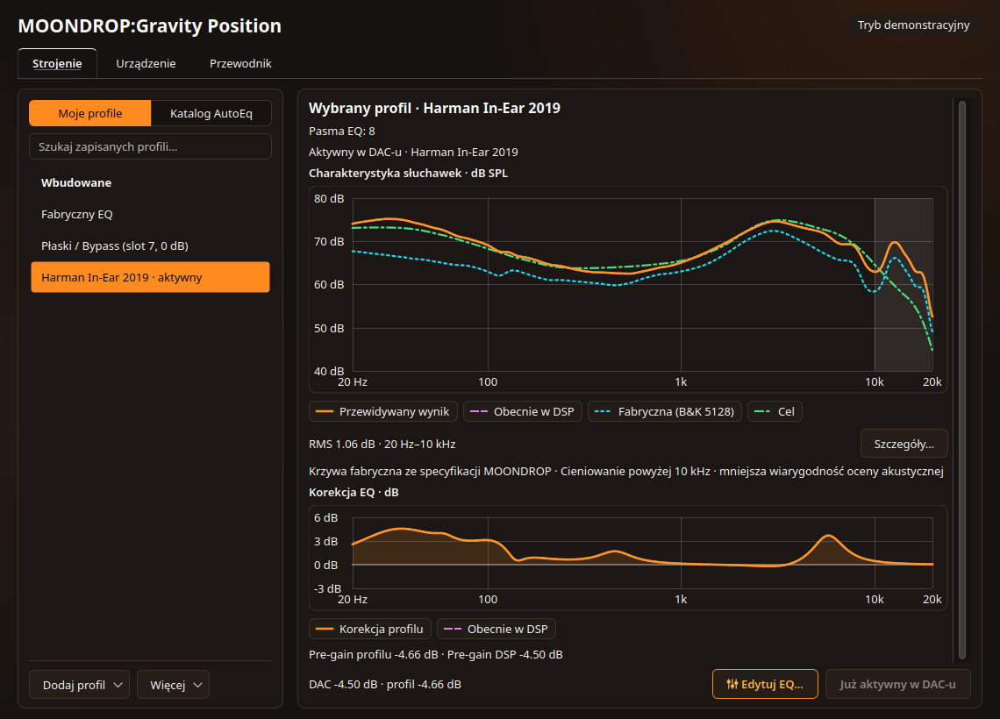
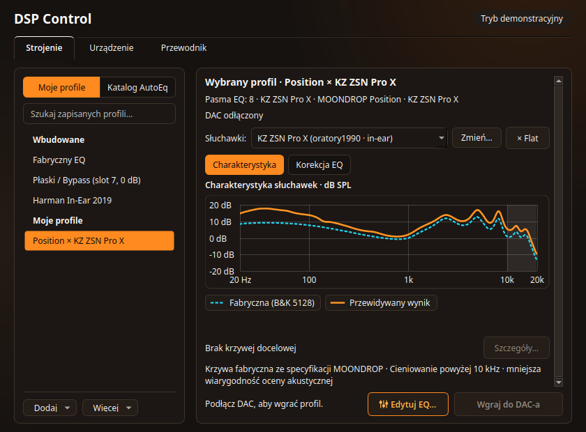
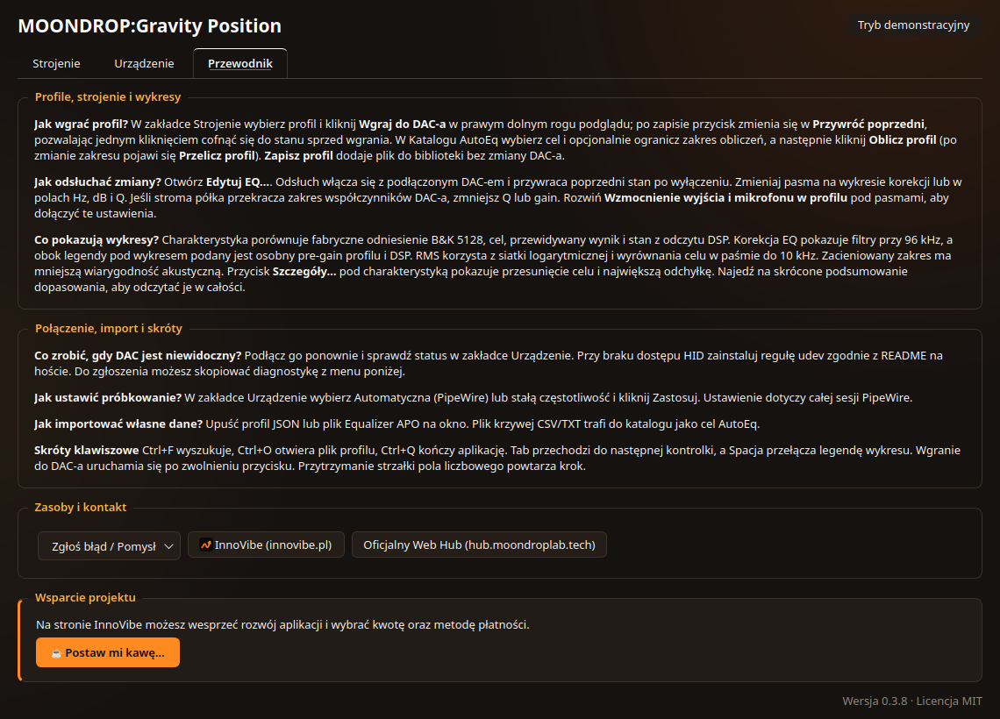

# DSP Control

🌐 **Język:** [English](README.md) | Polski

[-2ea44f?logo=linux&logoColor=white)](#szybki-start)
[](#szybki-start)
[-41cd52?logo=qt&logoColor=white)](#zrzuty-ekranu)
[](LICENSE)

**Natywny kontroler sprzętowego DSP, AutoEq i PipeWire dla DAC-ów USB-C MOONDROP na Linuxie — zero obciążenia CPU, wbudowany indeks 6800+ modeli AutoEq offline, odblokowane filtry półkowe `LSQ`/`HSQ` oraz odsłuch na żywo.**

[Obsługiwany sprzęt](#obsługiwany-sprzęt) · [Szybki start](#szybki-start) · [Dlaczego DSP Control?](#dlaczego-wersja-dla-linuxa) · [Zrzuty ekranu](#zrzuty-ekranu) · [Dokumentacja](#dokumentacja-techniczna) · [Wsparcie](#wsparcie-dla-projektu)



---

## Obsługiwany sprzęt

| Model | USB VID:PID | EQ i filtry | Status |
|---|---|---|---|
| **MOONDROP:Gravity Position** | `35d8:0123` | 8 pasm (`PK`, `LSQ`, `HSQ`, `LP`, `HP`), pre-gain | **Potwierdzony** na fizycznym sprzęcie (Flatpak + źródła) |
| **MOONDROP CHU II DSP** | `31b2:0113` | 5 pasm (`PK`, `LSQ`, `HSQ`), KTMicro KT0210 | **Eksperymentalny** (ze źródeł, zweryfikowany na próbkach HID) |
| **MOONDROP ECHO-A** | `3302:12c5` | 8 pasm (`PK`, `LSQ`, `HSQ`, `LP`, `HP`), WalkPlay | **Eksperymentalny** (ze źródeł, zweryfikowany na próbkach HID) |

> [!NOTE]
> **Masz CHU II DSP lub ECHO-A?** Pomóż potwierdzić obsługę na fizycznym sprzęcie! Zobacz [**Instrukcję dla testerów**](docs/tester-guide.pl.md) i prześlij [**raport z testów**](https://github.com/tom3k5/moondrop-position-dac/issues/new?template=hardware-test-report.yml) (z bezrootowym `--diagnose`).

---

## Szybki start

DSP Control zawiera wbudowany indeks modeli i źródeł AutoEq oraz 9 krzywych celu MIT działających offline od pierwszego uruchomienia; odświeżanie indeksu i pobieranie pomiarów działa przez HTTPS bez logowania i bez limitów REST API GitHuba.

### 1. Instalacja z paczki Flatpak (Zalecane dla Position)
Pobierz plik `dsp-control.flatpak` z [**GitHub Releases**](https://github.com/tom3k5/moondrop-position-dac/releases/latest) (zawiera PySide6 i pełny optymalizator AutoEq):

```bash
flatpak install --user dsp-control.flatpak
flatpak run pl.innovibe.DspControl
```

### 2. Dostęp USB HID (jednorazowa reguła `udev`)
Samo odtwarzanie audio działa od razu w PipeWire. Aby sterować DSP/EQ z konta zwykłego użytkownika przez `/dev/hidraw*` (wymagane dla Flatpaka i wersji ze źródeł):

```bash
sudo cp udev/70-dsp-control.rules /etc/udev/rules.d/
sudo udevadm control --reload-rules && sudo udevadm trigger
```

Podłącz ponownie DAC i sprawdź wykrywanie bez uprawnień roota:

```bash
python3 scripts/dsp_control.py --diagnose
```

Jeśli podłączono więcej niż jeden obsługiwany DAC, użyj polecenia `list` w CLI HID i przekaż `--device /dev/hidrawN` (albo wybierz egzemplarz w zakładce **Urządzenie**). Jeden DAC wybierany jest automatycznie.

### 3. Uruchomienie ze źródeł (eksperymentalne CHU II DSP / ECHO-A lub tryb `--demo`)
Przetestuj cały interfejs, katalog AutoEq i edytor EQ bez podłączania DAC-a:

```bash
git clone https://github.com/tom3k5/moondrop-position-dac.git
cd moondrop-position-dac
python3 scripts/dsp_control.py --demo
# Lub podgląd innego modelu DAC w trybie demo:
python3 scripts/dsp_control.py --demo --model moondrop-chu2-dsp
python3 scripts/dsp_control.py --demo --model moondrop-echo-a
```

Aby uruchomić wersję ze źródeł z fizycznym DAC-em (w tym eksperymentalne **CHU II DSP** / **ECHO-A**), pomiń `--demo`:

```bash
python3 scripts/dsp_control.py
```

*(Opcjonalnie: do uruchamiania optymalizatora AutoEq ze źródeł skonfiguruj `.venvs/autoeq` z Pythonem 3.11 zgodnie z [`docs/autoeq-integration.md`](docs/autoeq-integration.md).)*

<details>
<summary>Lokalna budowa Flatpaka i uprawnienia sandboxa</summary>

```bash
flatpak-builder --force-clean --disable-rofiles-fuse --repo=flatpak-repo flatpak-build pl.innovibe.DspControl.json
flatpak build-bundle flatpak-repo dsp-control.flatpak pl.innovibe.DspControl
```

Manifest ([`pl.innovibe.DspControl.json`](pl.innovibe.DspControl.json)) używa `--device=all` (dostęp do `/dev/hidraw*`), `--share=network` (pobieranie katalogu AutoEq na żądanie), `--talk-name=org.kde.StatusNotifierWatcher` (zasobnik systemowy) oraz `--socket=wayland` / `--socket=fallback-x11` / `--share=ipc` (okno aplikacji). Do pracy całkowicie offline użyj `flatpak run --unshare=network pl.innovibe.DspControl`.

</details>

---

## Dlaczego wersja dla Linuxa?

- **Sprzętowe DSP, zero obciążenia CPU:** Korektor parametryczny działa bezpośrednio na układzie DAC-a (`< 5 ms` opóźnienia) i pozostaje aktywny w grach (Steam/Proton, natywne), na Discordzie i w odtwarzaczach — nawet po zamknięciu aplikacji.
- **Odblokowane filtry półkowe `LSQ` i `HSQ`:** Podczas gdy `hub.moondroplab.tech` wyłącza półki dla Position (`PK / LP / HP`), DSP Control odblokowuje sprzętowe `LSQ` i `HSQ` (potwierdzone na firmware `0.5`). AutoEq domyślnie używa układu `1× LSQ + 1× HSQ + 6× PK`, zmniejszając błąd dopasowania Harman In-Ear 2019 z `2,20 dB` do `0,47 dB` RMS.
- **Krzywe, profile i wybór słuchawek per DAC:** Każdy model korzysta z modularnej definicji w [`data/devices/`](data/devices/README.md) (liczba pasm, próbkowanie, typy filtrów, krzywa bazowa), filtruje listę *Moje profile* do podpiętego DAC-a i pozwala wybrać dowolne słuchawki z katalogu AutoEq (np. `KZ ZSN Pro X`), własny plik CSV/TXT lub tryb **Flat**.
- **Bezpieczna praca offline:** Przeglądanie, obliczenia AutoEq i zapis profili na dysku są oddzielone od pamięci flash DAC-a. Każde wgranie wykonuje weryfikację przed/po zapisie, a odsłuch na żywo automatycznie przywraca poprzedni stan po anulowaniu.
- **Zasobnik systemowy i kontrola PipeWire:** Przełączaj profile dwoma kliknięciami z traya, sprawdzaj aktywną głębię bitową ALSA i wymuszaj próbkowanie PipeWire (`44,1–384 kHz`).

| Funkcja | Oficjalny Web Hub | DSP Control |
|---|---|---|
| EQ parametryczny (`PK / LSQ / HSQ / LP / HP`) + Pre-gain | Tylko `PK / LP / HP` (półki wyłączone na Position) | **Odblokowuje `LSQ / HSQ` (`1× LSQ + 1× HSQ + 6× PK`), natywny USB HID `0x4B`, offline** |
| Interaktywny wykres EQ i zapas do przesteru | Tylko suwaki | **Przeciąganie punktów na wykresie (Hz/dB/kółko Q) + automatyczny pre-gain** |
| Odsłuch na żywo (`Live preview`) | Tak | **Tak — włącza się automatycznie i bezpiecznie przywraca stan po anulowaniu** |
| Wbudowany optymalizator AutoEq | Podstawowe presety | **Indeks 6800+ offline + 9 targetów MIT + podgląd celu + zakres + Drag & Drop** |
| Porównanie z obecnym DSP i interaktywna legenda | Nie | **Krzywa `Obecnie w DSP` na obu wykresach, ukrywanie/solo pigułek, `Hz / dB / Δ dB`** |
| Wzmocnienie wyjścia (`-18…0 dB`) i mikrofonu | Tak | **Tak, z opcjonalnym zapisem w profilu** |
| Biblioteka lokalna vs flash DAC-a | Ograniczone | **Pełna biblioteka na dysku, Drag & Drop, import/eksport JSON i Equalizer APO (`.txt`)** |
| Monitor strumienia UAC2 i próbkowania PipeWire | Nie | **Tak (`44,1–384 kHz` + odczyt głębi bitowej ALSA)** |
| Weryfikacja zapisu i diagnostyka | Podstawowa | **Weryfikacja przed/po zapisie flash, Przywróć poprzedni, bezrootowy `--diagnose`** |
| Motywy, język i wbudowany Przewodnik | Tylko web | **Motywy InnoVibe Ciemny i Jasny, PL / EN, zakładka Przewodnik** |

---

## Zrzuty ekranu

### 1. Strojenie i podgląd charakterystyki
**Wybrany profil** i **Aktywny w DAC-u** są wyraźnie rozdzielone, dopóki nie klikniesz **Wgraj do DAC-a** (po zapisie przycisk zamienia się w **Przywróć poprzedni**). **Charakterystyka słuchawek** porównuje krzywą **Fabryczną (B&K 5128)**, **Cel**, **Przewidywany wynik** oraz **Obecnie w DSP**, a **Korekcja EQ** pokazuje odpowiedź filtrów przy `96 kHz`.

<details>
<summary>Strojenie w małym oknie (640×620)</summary>



</details>

### 2. Wbudowany katalog AutoEq (ponad 6800 modeli)
Filtruj tysiące pomiarów według **Źródła**, **Typu słuchawek** i **Zakresu obliczeń** (`20 Hz–20 kHz` lub `6 / 4 / 2 kHz`) albo przeciągnij na okno własną krzywą `.csv` / `.txt`.


### 3. Edytor EQ i odsłuch na żywo
Przeciągaj punkty bezpośrednio na wykresie **Korekcja EQ**, zmieniaj Q kółkiem myszy i użyj **Ustaw automatycznie** do doboru pre-gainu. Przy podłączonym DAC-u **Odsłuch na żywo** uruchamia się automatycznie i bezpiecznie przywraca stan po anulowaniu.


### 4. Stan urządzenia, wzmocnienie i jakość PipeWire UAC2
Podglądaj aktywny strumień ALSA, ustawiaj **Próbkowanie PipeWire** (`44,1–384 kHz`), eksportuj/przywracaj kopie zapasowe oraz przełączaj motywy (**InnoVibe Ciemny / Jasny**) i języki (**PL / EN**).


<details>
<summary>Urządzenie w małym oknie</summary>


</details>

### 5. Wbudowany Przewodnik, skróty i diagnostyka
Instrukcje wewnątrz aplikacji, skróty klawiszowe (`Ctrl+F`, `Ctrl+O`, `Ctrl+Q`), kopiowanie diagnostyki jednym kliknięciem oraz odnośniki do wsparcia.



---

## Dokumentacja techniczna

- [`docs/hid-protocol.md`](docs/hid-protocol.md) — Pełna specyfikacja protokołu USB HID `0x4B` (współczynniki Q2.30, sloty, pre-gain, global/mic gain).
- [`docs/autoeq-integration.md`](docs/autoeq-integration.md) — Szczegóły integracji katalogu AutoEq i optymalizacji 8 pasm (`LSQ + HSQ + 6× PK` / `PK`).
- [`docs/tester-guide.pl.md`](docs/tester-guide.pl.md) — Instrukcja testów sprzętowych dla właścicieli CHU II DSP i ECHO-A.
- [`docs/sources.md`](docs/sources.md) — Deskryptory USB/UAC2 i otwarte źródła referencyjne.

---

## Wsparcie dla projektu

> [!TIP]
> **Podoba Ci się DSP Control?**
> Jeśli aplikacja pomaga Ci wycisnąć lepsze brzmienie ze swojego DAC-a na Linuxie, możesz wesprzeć jej dalszy rozwój — każda kawa pomaga w kolejnych aktualizacjach, testach sprzętowych i nowych funkcjach!

- ☕ **Postaw mi kawę:** Odwiedź [**stronę wsparcia InnoVibe**](https://innovibe.pl/ko-fi/) albo kliknij **Postaw mi kawę…** w zakładce **Przewodnik**.
- 🌐 **Strona projektu:** [DSP Control na InnoVibe](https://innovibe.pl/dsp-control/)
- 🐛 **Błędy, raporty sprzętowe i pomysły:** Prześlij [raport z testów sprzętowych](https://github.com/tom3k5/moondrop-position-dac/issues/new?template=hardware-test-report.yml) lub otwórz zgłoszenie na [GitHub Issues](https://github.com/tom3k5/moondrop-position-dac/issues/new/choose).
