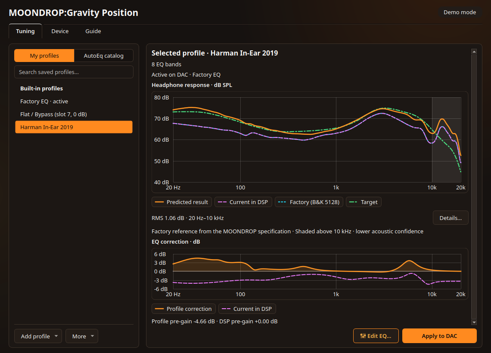
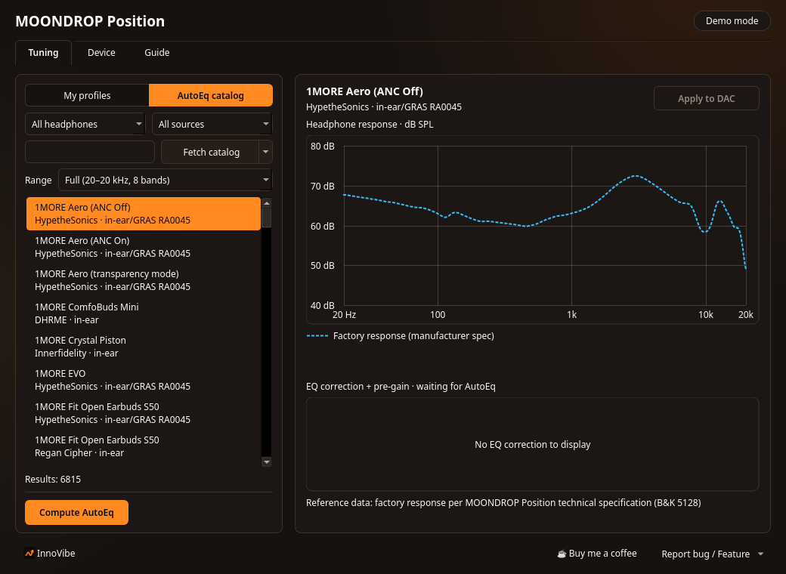
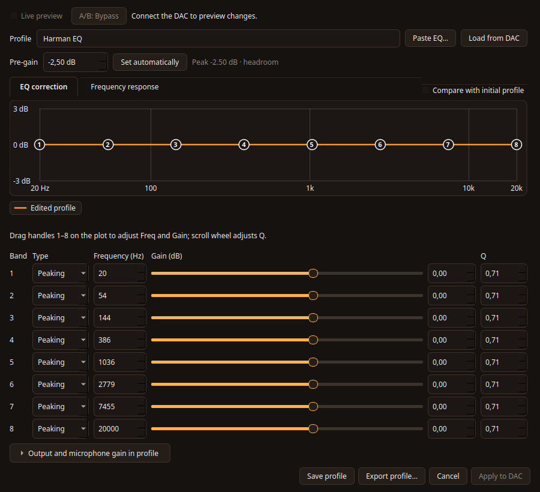
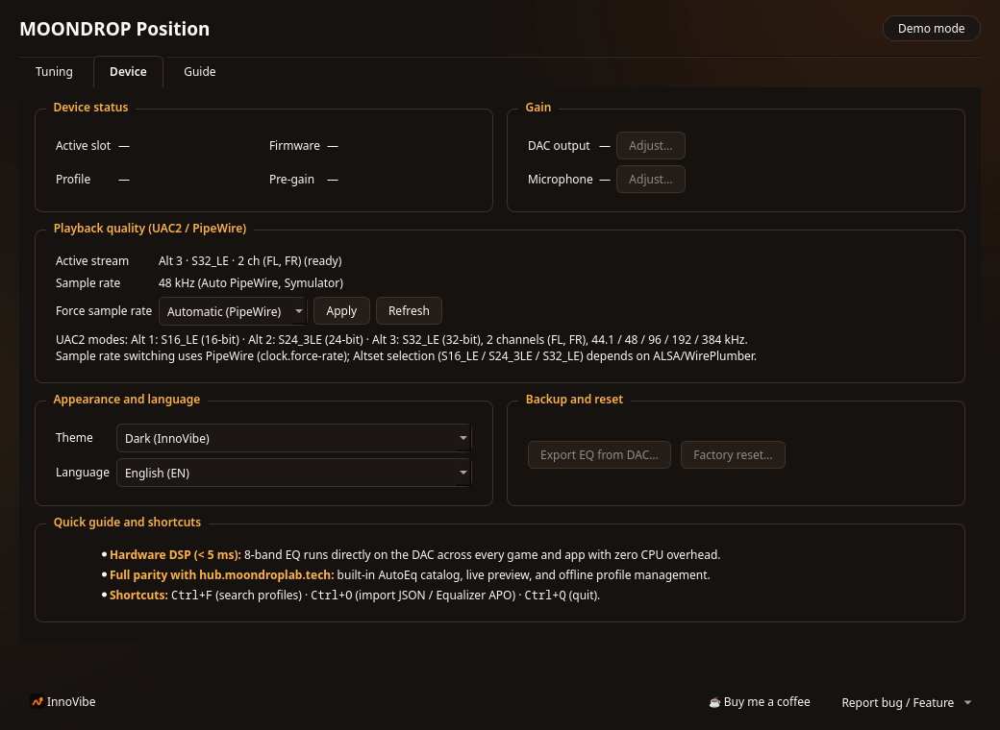
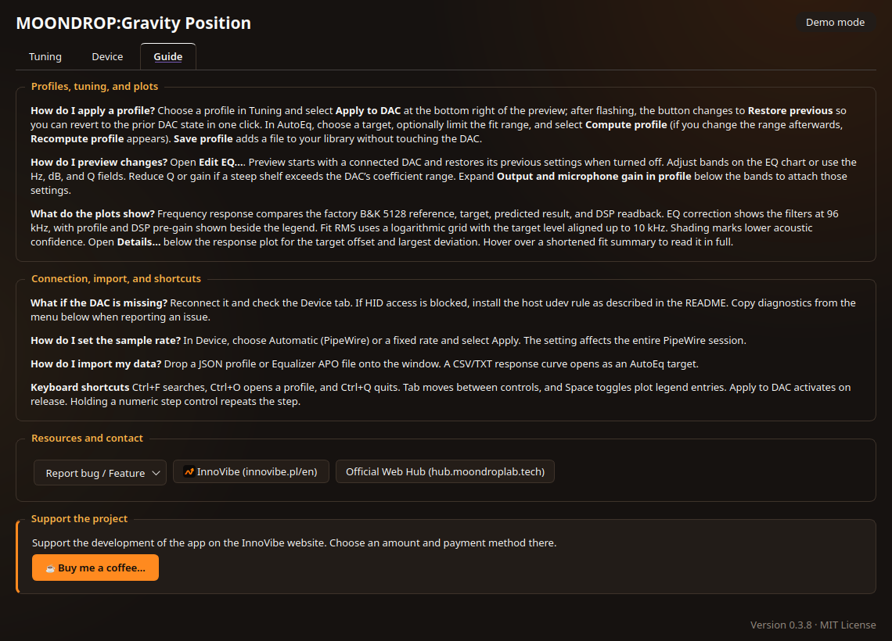

# MOONDROP:Gravity Position — Natywny kontroler DSP, AutoEq i Audio dla Linuxa

🌐 **Język:** [English](README.md) | Polski

[-2ea44f?logo=linux&logoColor=white)](#szybki-start)
[](#szybki-start)
[-41cd52?logo=qt&logoColor=white)](#zrzuty-ekranu)
[](LICENSE)

**Odblokuj pełne możliwości sprzętowego DSP w swoim MOONDROP:Gravity Position (`35d8:0123`) natywnie na Linuxie — bez przeglądarki, bez obciążania CPU i z wbudowanym AutoEq.**

Niezależnie od tego, czy grasz w strzelanki na Steam/Proton, czy stroisz swoje IEM-y pod krzywą Harmana albo własne pomiary REW — ta aplikacja przenosi **100% możliwości oficjalnego konfiguratora webowego ([hub.moondroplab.tech](https://hub.moondroplab.tech/))** na pulpit Linuxa i dokłada tysiące profili AutoEq oraz kontrolę PipeWire UAC2.

---

## Dlaczego wersja dla Linuxa?

### 1. Granie na Linuxie i niskie opóźnienia
- **Sprzętowe DSP bez obciążania CPU:** 8-pasmowy korektor parametryczny działa bezpośrednio na układzie DAC-a (`< 5 ms` opóźnienia). Twój profil EQ działa w każdej grze (Steam/Proton, natywne), na Discordzie i w odtwarzaczu — nawet po zamknięciu aplikacji lub podłączeniu do innego komputera.
- **Kontrola jakości UAC2 / PipeWire:** Podgląd aktywnego strumienia ALSA (`S16_LE` / `S24_3LE` / `S32_LE`) i wymuszanie częstotliwości próbkowania (`44,1–384 kHz`) w PipeWire z poziomu zakładki **Urządzenie**.
- **Zasobnik systemowy (Tray):** Schowaj okno do traya i przełączaj profile EQ dwoma kliknięciami między graniem, muzyką a rozmowami.

### 2. Ogromna baza AutoEq w jednym miejscu
- **Tysiące pomiarów IEM i słuchawek nausznych z podglądem na żywo:** Przeglądaj i filtruj katalog AutoEq (Crinacle, Oratory1990, Rtings i inni), wczytuj krzywe REW/CSV/TXT albo **przeciągaj i upuszczaj (Drag & Drop)** pliki `.json`, Equalizer APO `.txt` i `.csv` bezpośrednio na okno aplikacji. Wybór modelu od razu rysuje jego krzywą docelową na tle bazy fabrycznej oraz **Obecnie w DSP** jeszcze przed uruchomieniem obliczeń.
- **Interaktywna legenda i odczyt różnicy (`Δ dB`):** Klikaj pigułki pod wykresem, aby ukrywać/pokazywać wybrane krzywe na obu wykresach, najedź na pigułkę, aby podświetlić krzywą w trybie **Solo**, i najedź na wykres, aby odczytać na żywo wartości `Hz / dB / Δ dB` względem aktualnego DSP.
- **Optymalizacja pod 8 pasm sprzętowych (`1× LSQ + 1× HSQ + 6× PK`):** Automatyczne dopasowanie wybranego celu dokładnie do limitów MOONDROP:Gravity Position (`96 kHz` DSP, `PK / LSQ / HSQ / LP / HP`, `20–20 000 Hz`, `-18…+12 dB`). W przeciwieństwie do aplikacji producenta (`hub.moondroplab.tech`, która wyłącza filtry półkowe dla Position i udostępnia wyłącznie `PK / LP / HP`), nasza aplikacja odblokowuje sprzętowe półki `LSQ` i `HSQ` (potwierdzone na firmware 0.5) i domyślnie używa w AutoEq układu `1× LSQ + 1× HSQ + 6× PK` — co daje **znacząco mniejsze odchylenie** od oczekiwanej krzywej (np. `0,47 dB` RMS / max `3,12 dB` wobec `2,20 dB` RMS / max `12,48 dB` przy samych `8× PK` dla Position → Harman In-Ear 2019). Dostępny jest też wybór **zakresu dopasowania** (`Pełny 20–20 kHz`, `Do 6 kHz`, `4 kHz`, `2 kHz`), pozwalający zostawić wyższe pasma wolne do ręcznego strojenia góry.

### 3. Pełna funkcjonalność `hub.moondroplab.tech` + praca offline
| Funkcja | Oficjalny Web Hub | MOONDROP:Gravity Position na Linux |
|---|---|---|
| 8-pasmowy EQ parametryczny (`PK / LSQ / HSQ / LP / HP`) + Pre-gain | Tak (tylko `PK / LP / HP` — półki wyłączone) | **Tak — odblokowuje `LSQ / HSQ` (`1× LSQ + 1× HSQ + 6× PK`, znacznie mniejszy błąd dopasowania, natywny USB HID `0x4B`, offline)** |
| Interaktywne punkty na wykresie + Auto Headroom | Tylko suwaki | **Przeciąganie punktów `1–8` (Hz/dB/kółko Q) + Auto Headroom i ostrzeżenie przed clippingiem** |
| Odsłuch na żywo (`Live preview`) | Tak | **Tak, z automatycznym przywracaniem stanu przy anulowaniu** |
| Wbudowany optymalizator AutoEq | Podstawowe presety | **Pełny katalog AutoEq + podgląd celu przed obliczeniem + zakres dopasowania + Drag & Drop CSV/TXT** |
| Porównanie z obecnym DSP i interaktywna legenda | Nie | **Krzywa `Obecnie w DSP` na obu wykresach, przełączanie/solo pigułek legendy, odczyt `Hz / dB / Δ dB`** |
| Wzmocnienie wyjścia (`-18…0 dB`) i mikrofonu | Tak | **Tak, z opcjonalnym zapisem w profilu** |
| Oddzielna biblioteka na dysku vs pamięć flash DAC-a | Ograniczone | **Pełna biblioteka lokalna, Drag & Drop, import/eksport JSON i Equalizer APO** |
| Monitor strumienia UAC2 i próbkowania PipeWire | Nie | **Tak (`44,1–384 kHz` + odczyt głębi bitowej ALSA)** |
| Weryfikacja zapisu i kopia zapasowa | Podstawowa | **Weryfikacja przed/po zapisie flash + eksport kopii** |
| Motywy, język i wbudowany Przewodnik | Tylko web | **Motywy InnoVibe Ciemny i Jasny, PL / EN, zakładka Przewodnik** |

---

## Zrzuty ekranu

### Strojenie i podgląd charakterystyki
Górny wykres pokazuje **krzywą fabryczną**, **cel** i **przewidywany wynik**. **Korekcja EQ** pokazuje sumaryczną odpowiedź elektryczną filtrów przy 96 kHz. Pod nią są wartości pre-gainu profilu i DSP. Krzywa **Obecnie w DSP** korzysta z odczytanych współczynników biquad, także po użyciu **Wgraj do DAC-a**.

RMS dopasowania korzysta z siatki logarytmicznej we wspólnym paśmie 20 Hz–10 kHz. Poziom celu wyrównuje jedno średnie przesunięcie. Po najechaniu na wynik widać wartość przesunięcia i największą odchyłkę w tym paśmie. Cieniowanie powyżej 10 kHz oznacza mniejszą wiarygodność oceny akustycznej.



### Wbudowany katalog AutoEq
Filtrowanie po typie słuchawek, źródle pomiaru oraz **zakresie częstotliwości dopasowania** (`20–20 kHz` lub do `6 / 4 / 2 kHz`):


### Edytor 8-pasmowego EQ (interaktywne punkty i odsłuch na żywo)
Przeciąganie ponumerowanych punktów `1–8` bezpośrednio na wykresie (Hz / dB / kółko Q), przycisk **Auto Headroom** z wykrywaniem clippingu oraz eksport do JSON i Equalizer APO (`.txt`):


### Stan urządzenia, wzmocnienie i jakość PipeWire UAC2
Dwukolumnowy widok bez przewijania: odczyt DAC-a, wzmocnienie, próbkowanie UAC2/PipeWire oraz wybór motywu i języka:


### Wbudowany Przewodnik, skróty i wsparcie


---

## Szybki start

### 1. Wypróbuj symulator (bez podłączania sprzętu)
Możesz przetestować cały interfejs, wykresy, katalog AutoEq i edytor EQ bez fizycznego DAC-a:

```bash
git clone https://github.com/tom3k5/moondrop-position-dac.git
cd moondrop-position-dac
python3 skrypty/position_gui.py --demo
```

### 2. Dostęp USB HID na Linuxie (jednorazowa reguła `udev`)
Samo odtwarzanie audio działa od razu w PipeWire. Do sterowania DSP/EQ z konta zwykłego użytkownika potrzebna jest reguła `udev` dla `/dev/hidraw*`:

```bash
sudo cp udev/70-moondrop-position.rules /etc/udev/rules.d/
sudo udevadm control --reload-rules && sudo udevadm trigger
```
Podłącz ponownie MOONDROP:Gravity Position i sprawdź połączenie:
```bash
python3 skrypty/position_gui.py --diagnose
```
Raport JSON zawiera aktywny slot, pre-gain, parametry pasm i surowe współczynniki Q2.30 zapisane szesnastkowo.

### 3. Instalacja z paczki Flatpak (Zalecane)
Pobierz najnowszy plik `position-dac.flatpak` z zakładki [**GitHub Releases**](https://github.com/tom3k5/moondrop-position-dac/releases/latest) (zawiera PySide6 oraz pełny optymalizator AutoEq):

```bash
flatpak install --user position-dac.flatpak
flatpak run local.moondrop.Position
```

*(Uwaga: aby sterować fizycznym DAC-em przez USB HID zarówno z Flatpaka, jak i ze źródeł, zainstaluj regułę `udev` na hoście z kroku 2.)*

### 4. Lub uruchom bezpośrednio ze źródeł
```bash
python3 skrypty/position_gui.py
```
*(Opcjonalnie: do uruchamiania optymalizatora AutoEq ze źródeł skonfiguruj środowisko `.venvs/autoeq` z Pythonem 3.11 zgodnie z [`docs/integracja-autoeq.md`](docs/integracja-autoeq.md).)*

### 5. Lokalna budowa Flatpaka i uprawnienia
```bash
flatpak-builder --force-clean --disable-rofiles-fuse --repo=flatpak-repo flatpak-build local.moondrop.Position.json
flatpak build-bundle flatpak-repo position-dac.flatpak local.moondrop.Position
```
Manifest Flatpak ([`local.moondrop.Position.json`](local.moondrop.Position.json)) używa `--device=all` (dostęp do `/dev/hidraw*` dla DSP), `--share=network` (pobieranie katalogu AutoEq na żądanie użytkownika), `--talk-name=org.kde.StatusNotifierWatcher` (ikona w zasobniku systemowym) oraz `--socket=wayland` / `--socket=fallback-x11` / `--share=ipc` (okno aplikacji).

---

## Wsparcie, zgłoszenia i autor

- **Autor:** [InnoVibe](https://www.innovibe.pl)
- **Postaw mi kawę:** Podoba Ci się projekt? [Wesprzyj rozwój (płatności PL i EU)](https://innovibe.pl/ko-fi/) — lub kliknij **☕ Postaw mi kawę** bezpośrednio w stopce aplikacji.
- **Znalazłeś błąd lub masz pomysł?** Użyj przycisku **Zgłoś błąd / Pomysł** w aplikacji (z kopią diagnostyki jednym kliknięciem) albo otwórz zgłoszenie na [GitHub Issues](https://github.com/tom3k5/moondrop-position-dac/issues/new/choose). Strukturyzowane formularze są automatycznie oznaczane etykietą obszaru.

---

## Dokumentacja techniczna

- [`docs/protokol-hid.md`](docs/protokol-hid.md) — Pełna specyfikacja protokołu USB HID `0x4B` (współczynniki Q2.30, sloty, pre-gain, global/mic gain).
- [`docs/integracja-autoeq.md`](docs/integracja-autoeq.md) — Szczegóły integracji katalogu AutoEq i optymalizacji 8 pasm (`LSQ + HSQ + 6× PK` / `PK`).
- [`docs/zrodla.md`](docs/zrodla.md) — Deskryptory USB/UAC2 i pliki referencyjne.
