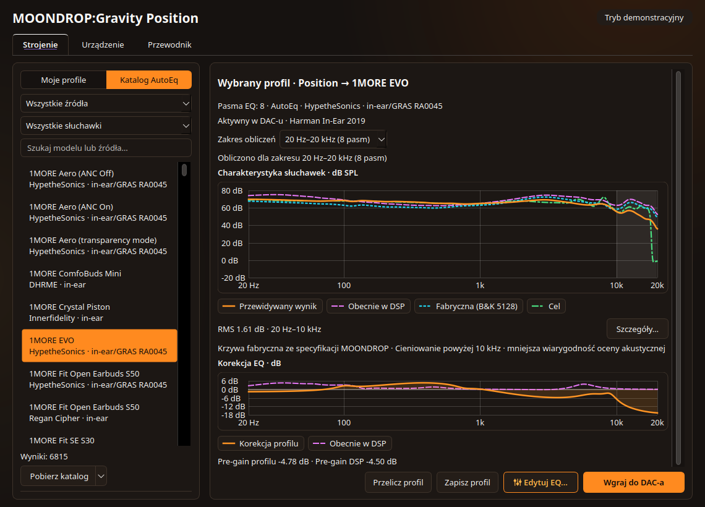
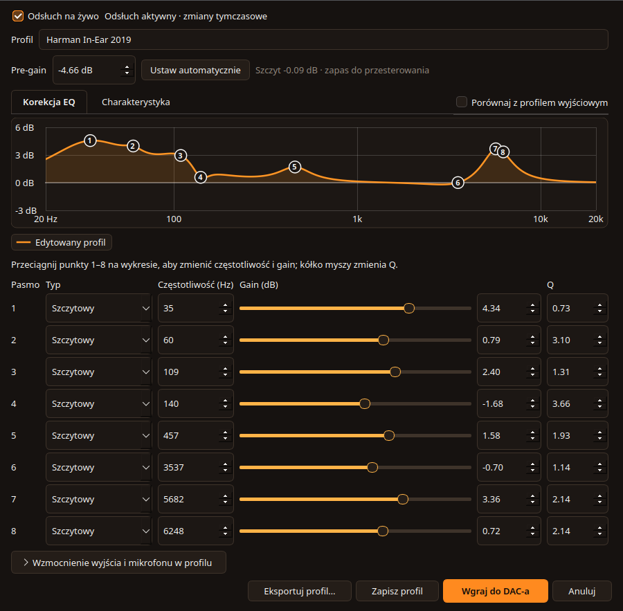
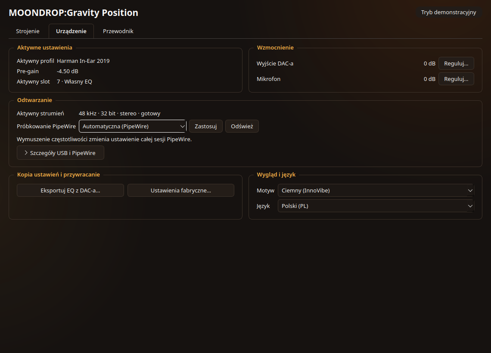
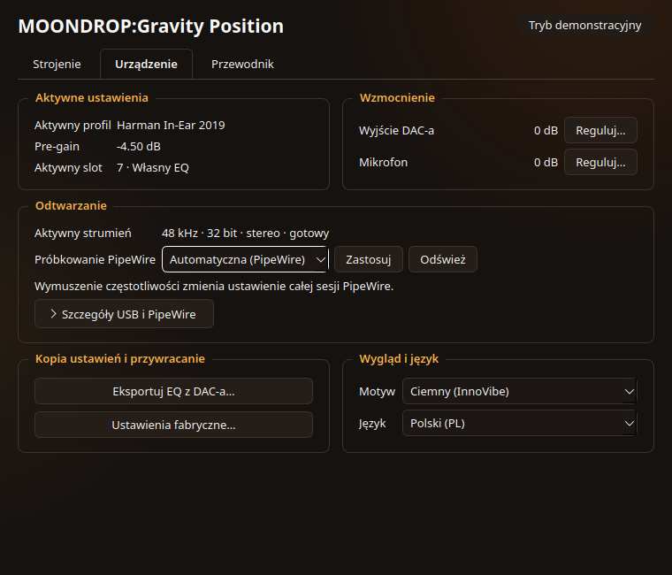

# DSP Control

🌐 **Język:** [English](README.md) | Polski

[-2ea44f?logo=linux&logoColor=white)](#szybki-start)
[](#szybki-start)
[-41cd52?logo=qt&logoColor=white)](#zrzuty-ekranu)
[](LICENSE)

**Natywny kontroler sprzętowego DSP i AutoEq dla DAC-ów USB-C MOONDROP na Linuxie — zero obciążenia CPU, wbudowany katalog 6800+ słuchawek offline, szybka korekta barwy, porównywanie Profil A vs Profil B i odsłuch A/B na żywo.**

[Najważniejsze możliwości](#najważniejsze-możliwości) · [Szybki start](#szybki-start) · [Obsługiwany sprzęt](#obsługiwany-sprzęt) · [Zrzuty ekranu](#zrzuty-ekranu) · [vs Web Hub](#dsp-control-vs-oficjalny-web-hub) · [Dokumentacja](#dokumentacja-techniczna) · [Wsparcie](#wsparcie-dla-projektu)


---

## Najważniejsze możliwości

- **Dowolne słuchawki z Twoim DAC-iem (offline od startu):** Wbudowany indeks ponad 6800 modeli AutoEq i 9 krzywych celu MIT działa od pierwszego uruchomienia. Wybierz dowolne słuchawki (np. KZ ZSN Pro X, Sennheiser lub własny plik CSV/TXT), ustaw **Bas**, **Tilt** lub **Tylko PK** i wygeneruj gotowy profil EQ w kilka sekund.
- **Szybsze strojenie i bezpieczny odsłuch:** Przeciągaj punkty bezpośrednio na wykresie, używaj zawsze otwartej sekcji **Szybka korekta barwy** (**Bas → Średnica → Góra → Tilt**), wyciszaj (`Wł.`) lub tymczasowo podsłuchuj (`S`) pojedyncze pasma, wklejaj presety Equalizer APO / Squiglink i zeruj EQ jednym kliknięciem.
- **Wygodne porównywanie brzmienia:** Porównuj **Profil A vs Profil B** obok siebie na obu wykresach Strojenia oraz przełączaj odsłuch **A/B** w czasie rzeczywistym między **Flat (0 dB)**, **Stanem wyjściowym** lub **Profilem B** (w RAM, bez zapisu flash).
- **Sprzętowe DSP, zero obciążenia CPU:** Korekcja działa bezpośrednio na układzie DAC-a (`< 5 ms` opóźnienia) w grach (Steam/Proton, natywne), na Discordzie i w odtwarzaczach — nawet po zamknięciu aplikacji lub przepięciu adaptera do innego komputera. Odblokowuje sprzętowe filtry półkowe `LSQ`/`HSQ` w MOONDROP:Gravity Position.
- **Bezpieczna biblioteka i kopie zapasowe:** Zapis profili na dysku jest oddzielony od pamięci flash DAC-a (z weryfikacją przed/po zapisie i jednoklikowym **Przywróć poprzedni**). Eksportuj i importuj całą bibliotekę jako paczkę `.zip` (także przez Drag & Drop), z pamięcią ostatniego profilu i słuchawek dla każdego DAC-a.

---

## Szybki start

### 1. Zainstaluj z paczki Flatpak (Zalecane)
Pobierz plik `dsp-control.flatpak` z [**GitHub Releases**](https://github.com/tom3k5/moondrop-position-dac/releases/latest) (zawiera PySide6 oraz pełny optymalizator AutoEq):

```bash
flatpak install --user dsp-control.flatpak
```

### 2. Włącz dostęp USB HID (jednorazowa reguła `udev`)
Samo odtwarzanie audio działa od razu w PipeWire. Aby sterować DSP/EQ z konta zwykłego użytkownika przez `/dev/hidraw*`:

```bash
sudo cp udev/70-dsp-control.rules /etc/udev/rules.d/
sudo udevadm control --reload-rules && sudo udevadm trigger
```

Podłącz ponownie DAC i uruchom aplikację:

```bash
flatpak run pl.innovibe.DspControl
```

<details>
<summary>Uruchomienie ze źródeł, tryb <code>--demo</code> bez DAC-a lub lokalna budowa Flatpaka</summary>

Przetestuj cały interfejs, katalog AutoEq i edytor EQ bez podłączania sprzętu:

```bash
git clone https://github.com/tom3k5/moondrop-position-dac.git
cd moondrop-position-dac
python3 scripts/dsp_control.py --demo
# Podgląd innego modelu DAC w trybie demo:
python3 scripts/dsp_control.py --demo --model moondrop-chu2-dsp
python3 scripts/dsp_control.py --demo --model moondrop-echo-a
```

Uruchomienie ze źródeł z fizycznym DAC-em (w tym eksperymentalne **CHU II DSP** / **ECHO-A**) lub diagnostyka bez uprawnień roota:

```bash
python3 scripts/dsp_control.py --diagnose
python3 scripts/dsp_control.py
```

*(Opcjonalnie: do uruchamiania optymalizatora AutoEq ze źródeł skonfiguruj `.venvs/autoeq` z Pythonem 3.11 zgodnie z [`docs/autoeq-integration.md`](docs/autoeq-integration.md).)*

Lokalna budowa Flatpaka:

```bash
flatpak-builder --force-clean --disable-rofiles-fuse --repo=flatpak-repo flatpak-build pl.innovibe.DspControl.json
flatpak build-bundle flatpak-repo dsp-control.flatpak pl.innovibe.DspControl
```

Manifest ([`pl.innovibe.DspControl.json`](pl.innovibe.DspControl.json)) używa `--device=all` (dostęp do `/dev/hidraw*`), `--share=network` (pobieranie katalogu AutoEq i sprawdzanie aktualizacji na żądanie), `--talk-name=org.kde.StatusNotifierWatcher` (zasobnik systemowy) oraz `--socket=wayland` / `--socket=fallback-x11` / `--share=ipc`. Do pracy całkowicie offline użyj `flatpak run --unshare=network pl.innovibe.DspControl`.

</details>

---

## Obsługiwany sprzęt

| Model | USB VID:PID | EQ i filtry | Status |
|---|---|---|---|
| **MOONDROP:Gravity Position** | `35d8:0123` | 8 pasm (`PK`, `LSQ`, `HSQ`, `LP`, `HP`), pre-gain | **Potwierdzony** na fizycznym sprzęcie (Flatpak + źródła) |
| **MOONDROP CHU II DSP** | `31b2:0113` | 5 pasm (`PK`, `LSQ`, `HSQ`), KTMicro KT0210 | **Eksperymentalny** (ze źródeł, zweryfikowany na próbkach HID) |
| **MOONDROP ECHO-A** | `3302:12c5` | 8 pasm (`PK`, `LSQ`, `HSQ`, `LP`, `HP`), WalkPlay | **Eksperymentalny** (ze źródeł, zweryfikowany na próbkach HID) |

> [!NOTE]
> **Masz CHU II DSP lub ECHO-A?** Pomóż potwierdzić obsługę na fizycznym sprzęcie! Zobacz [**Instrukcję dla testerów**](docs/tester-guide.pl.md) i prześlij [**raport z testów**](https://github.com/tom3k5/moondrop-position-dac/issues/new?template=hardware-test-report.yml) (z bezrootowym `--diagnose`).

---

## Zrzuty ekranu

### 1. Strojenie i porównanie Profil A vs Profil B
**Wybrany profil** i **Aktywny w DAC-u** są wyraźnie rozdzielone, dopóki nie klikniesz **Wgraj do DAC-a** (po zapisie przycisk zamienia się w **Przywróć poprzedni**). Pasek **Słuchawki** pozwala dobrać dowolny model, **Porównaj (B)** (lub prawy przycisk myszy na liście) nakłada drugi profil na oba wykresy, a menu **Dodaj ▾ / Więcej ▾** (lub Drag & Drop) obsługuje paczki biblioteki `.zip`.

<details>
<summary>Strojenie w małym oknie (640×620)</summary>


</details>

<br>

### 2. Wbudowany katalog AutoEq (ponad 6800 modeli)
Filtruj tysiące pomiarów według **Źródła**, **Typu słuchawek** i **Zakresu obliczeń** (`20 Hz–20 kHz` lub `6 / 4 / 2 kHz`), dostrój **Bas**, **Tilt** lub **Tylko PK** przed obliczeniem albo przeciągnij na okno własną krzywą `.csv` / `.txt`.



<br>

### 3. Edytor EQ, Szybka korekta barwy i odsłuch A/B
Przeciągaj punkty bezpośrednio na wykresie **Korekcja EQ**, zmieniaj Q kółkiem myszy, wyciszaj (`Wł.`) lub tymczasowo podsłuchuj (`S`) wybrane pasma i kształtuj brzmienie w sekcji **Szybka korekta barwy** (**Bas → Średnica → Góra → Tilt**). Przy podłączonym DAC-u **Odsłuch na żywo** pozwala porównywać przez **A/B** z **Flat**, **Stanem wyjściowym** lub **Profilem B** i bezpiecznie przywraca stan po anulowaniu.



<br>

### 4. Stan urządzenia, wzmocnienie i jakość PipeWire UAC2
Podglądaj aktywny strumień ALSA, ustawiaj **Próbkowanie PipeWire** (`44,1–384 kHz`), eksportuj/przywracaj kopie zapasowe oraz przełączaj motywy (**InnoVibe Ciemny / Jasny**) i języki (**PL / EN**).



<details>
<summary>Urządzenie w małym oknie</summary>



</details>

<br>

### 5. Wbudowany Przewodnik, aktualizacje i diagnostyka
Instrukcje wewnątrz aplikacji, skróty klawiszowe (`Ctrl+F`, `Ctrl+O`, `Ctrl+Q`), kopiowanie diagnostyki jednym kliknięciem oraz sprawdzanie aktualizacji z kopiowaniem komendy Flatpak.


---

## DSP Control vs Oficjalny Web Hub

| Funkcja | Oficjalny Web Hub | DSP Control |
|---|---|---|
| EQ parametryczny (`PK / LSQ / HSQ / LP / HP`) + Pre-gain | Tylko `PK / LP / HP` (półki wyłączone na Position) | **Odblokowuje `LSQ / HSQ` (`1× LSQ + 1× HSQ + 6× PK`), natywny USB HID `0x4B`, offline** |
| Edycja EQ i kształtowanie barwy | Tylko suwaki | **Przeciąganie punktów (Hz / dB / kółko Q), Szybka korekta barwy (`Bas / Średnica / Góra / Tilt`), Mute i Solo pasm, auto pre-gain + Wyzeruj EQ** |
| Odsłuch na żywo i A/B | Podstawowy | **Auto-odsłuch + wybór celu `A/B` (`Flat 0 dB` / `Stan wyjściowy` / `Profil B`) + bezpieczne przywracanie** |
| Optymalizator AutoEq | Podstawowe presety | **Indeks 6800+ offline + Bas / Tilt / Tylko PK + zakres + Drag & Drop** |
| Porównanie profili i DSP | Nie | **Krzywa `Obecnie w DSP` lub dowolny `Profil B` na obu wykresach, ukrywanie/solo pigułek, `Hz / dB / Δ dB`** |
| Biblioteka i przenoszenie profili | Ograniczone | **Pełna biblioteka lokalna, paczki `.zip` (Drag & Drop), pamięć profilu per DAC i słuchawek, wklejanie/import Equalizer APO** |
| PipeWire UAC2 i zasobnik | Nie | **Próbkowanie (`44,1–384 kHz`), odczyt głębi bitowej ALSA, przełączanie profili z traya** |
| Bezpieczeństwo i aktualizacje | Podstawowe | **Weryfikacja przed/po zapisie flash, Przywróć poprzedni, bezrootowy `--diagnose`, sprawdzanie aktualizacji w Przewodniku** |

---

## Dokumentacja techniczna

- [`docs/hid-protocol.md`](docs/hid-protocol.md) — Pełna specyfikacja protokołu USB HID `0x4B` (współczynniki Q2.30, sloty, pre-gain, global/mic gain).
- [`docs/autoeq-integration.md`](docs/autoeq-integration.md) — Szczegóły integracji katalogu AutoEq i optymalizacji 8 pasm (`LSQ + HSQ + 6× PK` / `PK`).
- [`docs/tester-guide.pl.md`](docs/tester-guide.pl.md) — Instrukcja testów sprzętowych dla właścicieli CHU II DSP i ECHO-A.
- [`docs/sources.md`](docs/sources.md) — Deskryptory USB/UAC2 i otwarte źródła referencyjne.

---

## Wsparcie dla projektu

> [!TIP]
> **Podoba Ci się DSP Control?**
> Jeśli aplikacja pomaga Ci wycisnąć lepsze brzmienie ze swojego DAC-a na Linuxie, możesz wesprzeć jej dalszy rozwój — każda kawa pomaga w kolejnych aktualizacjach, testach sprzętowych i nowych funkcjach!

- ☕ **Postaw mi kawę:** Odwiedź [**stronę wsparcia InnoVibe**](https://innovibe.pl/ko-fi/) albo kliknij **Postaw mi kawę…** w zakładce **Przewodnik**.
- 🌐 **Strona projektu:** [DSP Control na InnoVibe](https://innovibe.pl/dsp-control/)
- 🐛 **Błędy, raporty sprzętowe i pomysły:** Prześlij [raport z testów sprzętowych](https://github.com/tom3k5/moondrop-position-dac/issues/new?template=hardware-test-report.yml) lub otwórz zgłoszenie na [GitHub Issues](https://github.com/tom3k5/moondrop-position-dac/issues/new/choose).
